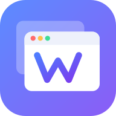

<div align="center">



# WebOS

**A tiny operating system that lives in your browser.**
Install websites as apps, open them in windows, add online services as shortcuts, and keep working offline.

[](https://webos.asf.run)

[](https://github.com/tasmon/WebOS)
[](LICENSE)
[](#-install-webos-itself)
[](#-works-offline)
[](#-privacy)
[](#-built-with)
[](#-built-with)

[](https://github.com/tasmon/WebOS/stargazers)
[](https://github.com/tasmon/WebOS/commits)
[](https://github.com/tasmon/WebOS/issues)
[](https://github.com/tasmon/WebOS)

</div>

---

## What is WebOS?

WebOS gives you a desktop inside your web browser. Take almost any static website, the kind people upload to GitHub, and **install it as an app**. It gets its own icon, opens in its own window, and keeps working without internet. For online services such as web mail or chat pages, add a **shortcut** that opens them in their own browser tab.

It also comes with a few useful apps built in, a Store full of apps shared by other people, themes and wallpapers, and a layout that works on phones, tablets and computers.

Use it to:

- Keep your favourite small web tools, games and utilities in one place.
- Try a website or project from GitHub in seconds, with no setup.
- Put the sites you use every day on one desktop.
- Carry your apps to any device by backing them up in a single file.
- Run your own HTML projects like real apps.

**Open it now: [webos.asf.run](https://webos.asf.run)**

---

## ✨ Highlights

| | |
| --- | --- |
| 🛍️ **Store** | Browse approved apps, see ratings, downloads and comments, and add them in one tap |
| 📦 **Install apps** | From a ZIP file, a folder, a GitHub link, or a web address |
| 🔗 **Web shortcuts** | Turn any website into an app icon that opens in its own browser tab |
| 🧰 **Built-in apps** | Browser, Media Player, PDF Reader and Tetris, ready to use |
| 🪟 **Real windows** | Move, resize, snap to screen edges, minimise and maximise |
| 🖥️ **A proper desktop** | Icons, taskbar, start menu with search, notifications, calendar |
| ✋ **Arrange your icons** | Drag icons anywhere, hide the ones you do not need, auto arrange in one tap |
| 🎨 **Make it yours** | Light or dark theme, accent colours, wallpapers or your own photo |
| ⚙️ **Practical settings** | Taskbar position, clock format, icon size, text size, window behaviour |
| 🔒 **Lock it** | Optional PIN lock screen |
| 💾 **Back up everything** | One file holds all your apps and settings |
| 📱 **Works on phones** | Windows open full screen and you switch with the taskbar |
| 📴 **Offline ready** | Installed apps and WebOS itself open without internet |

---

## 🧰 Built-in apps

| App | What it does |
| --- | --- |
| **Store** | Find apps shared by other people. Add them in one tap, rate them, and ask for new ones |
| **App Manager** | See what is installed, update apps, export one as a ZIP, clear its data or remove it |
| **Browser** | Open websites in a window, with bookmarks, a choice of search engines and a start page |
| **Media Player** | Play music and video from your device with a playlist, shuffle, repeat and speed control |
| **PDF Reader** | Read PDF files with smooth scrolling, zoom, page jump and fit-to-width |
| **Tetris** | The classic falling blocks game, with keyboard, touch buttons and swipe controls |
| **Settings** | Appearance, desktop, taskbar, windows, lock screen, storage and backups |
| **Help** | A full guide inside WebOS |
| **About** | Version, credits and a way to send a message to the admin |

> **A note on websites in windows.** Many big sites (WhatsApp Web, Google, YouTube, GitHub and others) tell the browser never to show them inside another page. That is their own rule and WebOS cannot change it. Shortcuts and the Browser open those sites in their own browser tab instead, where they work normally.

---

## 🔗 Web shortcuts

Some apps are really online services, for example `web.whatsapp.com`. You do not need to install anything for these:

1. Right-click the desktop and choose **Add web shortcut** (or use the start menu).
2. Type the website address. The name fills in for you.
3. Choose how it opens. **In its own browser tab** is recommended and works for every site. **Inside a WebOS window** works for sites that allow it.
4. Press **Add shortcut**. The icon appears on your desktop.

You can also add a shortcut from the Browser (menu → *Add as an app*), edit one later from the App Manager, and find ready-made web apps in the Store.

---

## 🚀 Install an app in one minute

1. **Open** [webos.asf.run](https://webos.asf.run).
2. **Get a ZIP** of a website. On GitHub, open any project and choose **Code → Download ZIP**.
3. **Drag the ZIP onto the desktop.** Or click **Install app** and pick the file.
4. **Press Install**, then double-click the new icon to open your app.

You can also paste a GitHub address such as `owner/repo` or a full `github.com` link, and WebOS fetches the files and installs them for you.

---

## 📦 Which apps work?

**Works:**
- Any website ZIP that contains an `index.html`.
- Plain HTML, CSS and JavaScript sites.
- React, Vue, Svelte and Vite projects, when you install the **built** folder (usually `dist` or `build`).

**Does not work as an installed app:**
- Apps that need their own server or database (PHP, Node, Python and similar).
- Raw source code that has not been built.

If an app runs online already, for example on GitHub Pages or another host, add it as a **web shortcut** instead.

---

## 🛍️ The Store

Open **Store** on the desktop to find apps made by other people. Nothing appears in the Store until it has been reviewed.

- **Two kinds of apps.** *GitHub apps* are installed into WebOS like any ZIP. *Web apps* are shortcuts that open an online app in its own browser tab.
- **Search, filter and sort** by most downloaded, top rated or newest.
- **Ratings, downloads and comments** help you choose. A free WebOS account lets you rate and comment.
- **Add in one tap.** GitHub apps are saved on your device. Web apps are added as desktop shortcuts.
- **Ask for an app.** Create an account and press **Request an app**. Send a public GitHub repository, or a website address for an online app. A repository with no `index.html`, because it runs on GitHub Pages, Vercel or similar, is listed as a web app. The admin reviews every request.
- **Become a reviewer.** Get 5 of your requested apps approved in a row and you can ask to become an app reviewer. Reviewers help check new requests. They cannot change or delete anything the admin added or decided.
- **Message the admin.** Signed-in users can ask for a feature or report a bug from **About → Send feedback**, and read the reply in the Store.
- **Forgot your password?** Answer your security questions to set a new one.

Your installed apps never leave your device. An account is only used by the Store.

---

## 📴 Works offline

Everything you install is stored in your browser, on your device. Once an app is installed, it opens without internet. Apps that load data from online services, and web shortcuts, still need a connection for that part.

## 📲 Install WebOS itself

WebOS can be installed like a normal app, so it opens in its own window and works offline.

- **Android (Chrome):** menu ⋮ → *Install app* or *Add to Home screen*
- **iPhone (Safari):** Share → *Add to Home Screen*
- **Desktop Chrome or Edge:** click the install icon in the address bar

---

## ⌨️ Keyboard shortcuts

| Keys | Action |
| --- | --- |
| `Alt` + `A` | Open the start menu |
| `Alt` + `I` | Install an app |
| `Alt` + `W` | Close the active window |
| `Alt` + `M` | Minimise the active window |
| `Alt` + `D` | Show the desktop |

Media Player: `Space` play or pause, `←` `→` seek, `↑` `↓` volume, `M` mute, `F` full screen, `N` next, `P` previous.
Tetris: arrow keys move and rotate, `Space` drops, `C` holds a piece, `P` pauses.

---

## 🔗 Share an app with a link

Send someone a link that installs an app in one click:

```
https://webos.asf.run/#install=github:owner/repo
https://webos.asf.run/#install=https://example.com/app.zip
```

---

## 💾 Your data and backups

- Everything stays **in your browser, on your device**. Nothing is uploaded.
- Clearing your browser's site data for webos.asf.run removes your apps, so make a backup first.
- **Back up:** Settings → Storage & backup → **Export everything**.
- **Restore:** Settings → Storage & backup → **Import a backup**, on any device.

## 🔐 Privacy

- No account is needed to use WebOS. An account is only for rating, commenting, requesting apps and messaging the admin in the Store. No tracking, no analytics.
- Apps run on the same address as WebOS, so they are not fully isolated from one another. **Only install apps from people you trust.**
- Websites you open through shortcuts or the Browser are run by their own publishers, not by WebOS.
- The PIN lock keeps casual visitors out. It is not encryption.

---

## 🧱 Built with

- **Plain JavaScript (ES modules), HTML and CSS.** No framework and no build step.
- **IndexedDB** keeps installed apps and settings on your device.
- A **service worker** serves installed apps from storage and makes everything work offline.
- A small **serverless API** powers Store accounts, ratings, requests and messages.
- **[JSZip](https://stuk.github.io/jszip/)** reads ZIP files and **[pdf.js](https://mozilla.github.io/pdf.js/)** renders PDFs. Both are bundled with the project.

### Project layout

| Path | Purpose |
| --- | --- |
| `index.html`, `style.css`, `main.js` | The desktop page, styling and shell (desktop, taskbar, start menu, lock screen) |
| `wm.js` | Window manager |
| `sw.js` | Service worker: serves installed apps and works offline |
| `installer.js`, `install-ui.js` | ZIP, folder and GitHub reading, app detection and install dialog |
| `app-*.js` | Built-in apps: Store, App Manager, Settings, Help, About, Browser, Media Player, PDF Reader, Tetris |
| `web-apps.js` | Web shortcuts |
| `store-api.js`, `api/` | Browser side and server side of the Store |
| `admin.html`, `admin.js`, `admin.css` | Admin dashboard for the Store |
| `db.js`, `settings.js`, `wallpaper.js`, `tile.js`, `ui.js`, `icons.js`, `pwa.js`, `config.js` | Support modules |
| `jszip.min.js`, `pdf.min.js`, `pdf.worker.min.js` | Bundled libraries |
| `manifest.webmanifest`, `icon*` | PWA metadata and icons |

---

## ❓ Quick answers

**An app will not open.** WebOS needs service workers, which are switched off in private or incognito windows. Use a normal window.

**The app window is blank.** The ZIP is probably source code. Install the `dist` or `build` folder instead.

**A website shortcut shows a blank page in a window.** That site does not allow being shown inside another page. Edit the shortcut and choose *In its own browser tab*.

**A GitHub install fails.** The repository must be public. You can also download the ZIP and drop it in.

**How do I update an app?** Install the newer ZIP again. WebOS offers to update it and keeps its saved data.

**How do I start over?** Settings → Storage & backup → Factory reset.

---

## 🛠️ Make an app for WebOS

Want your app to look right inside WebOS, or listed in the Store? Read **[DEVELOPERS.md](DEVELOPERS.md)**.

## 🤝 Feedback and contributions

Found a bug or have an idea? Open an [issue](https://github.com/tasmon/WebOS/issues), message the admin from **About → Send feedback** in WebOS, or email [tasmon@outlook.com](mailto:tasmon@outlook.com). Pull requests are welcome.

---

<div align="center">

Made by **Tasmon Islam** · [tasmon@outlook.com](mailto:tasmon@outlook.com)
Released under the [MIT License](LICENSE)
JSZip is © Stuart Knightley (MIT). pdf.js is © Mozilla and contributors ([Apache-2.0](https://www.apache.org/licenses/LICENSE-2.0)).

</div>
